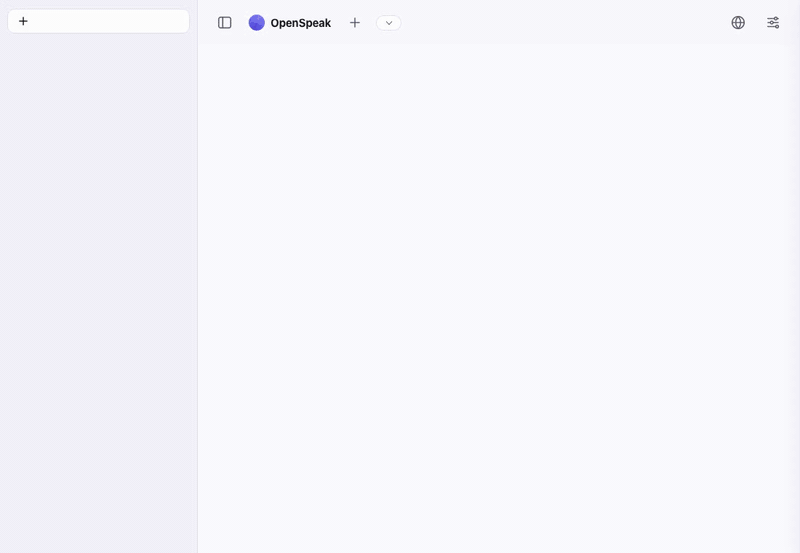
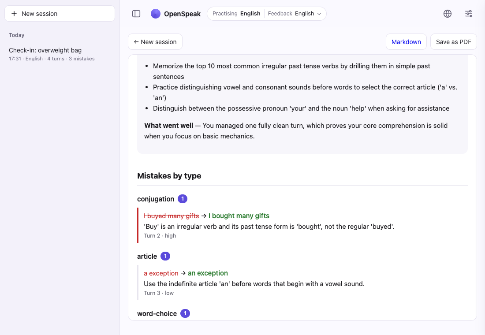

# OpenSpeak

**Talk freely with an AI partner in any language. Every mistake is graded silently in the background, and when you're done you get a study report.**

<p align="center"></p>

*A real session, from choosing a scene to the finished report, with a local model (Qwen3.8 27B in LM Studio). The wait while it grades is sped up; nothing is edited out. Here the replies are typed; with the microphone you just speak.*

Most AI speaking tutors either interrupt you to correct every sentence, or let you chat and forget everything. OpenSpeak does neither:

- **No interruptions.** The partner just talks with you. A second model grades each thing you say in the background and never breaks into the conversation.
- **A report you can study.** Mistakes grouped by grammar type with explanations, words and phrases worth keeping, and the whole conversation with corrections and natural rewrites. Click 🔊 to hear any line read aloud. Save it as PDF.
- **Grades speech, not writing.** Punctuation and capitalisation are ignored, because the speech recogniser guessed those. When you get stuck and drop into your own language, you get a hint, not a mistake.
- **Nothing gets lost.** What you say is saved the moment it's transcribed. Close the tab mid-conversation and you can pick it up again from the history sidebar, where you left off. If grading times out or the app crashes, the report can be completed later.
- **Doesn't make you wait.** The report is written in the background after you press *Finish*. A small card shows its progress, and tells you when it's ready.
- **Any language.** Choose what you practise, what language hints appear in, and what language the report is written in. There are 38 built-in languages, and you can type in any other the model knows.
- **Free, and yours.** It runs entirely on your own computer with open-source models. No account, no subscription, no telemetry. Nothing leaves your machine unless you choose a cloud service.
- **Three ways to start.** *Free talk* about anything; *Scenes*, 60 built-in situations for travel, daily life and business, where the partner opens in character; or *Custom*, a scene you describe yourself.

The report groups your mistakes by type, with the correction and why:

<p align="center"></p>

## Quick start: free and fully offline

You need a Mac or Linux computer with Python 3.10 or newer, a current browser (Chrome, Edge, Safari or Firefox) and a microphone. On Windows, [use Docker](#docker-windows-and-anywhere-else). Allow about 10 GB of disk and 16 GB of memory for a model that grades well (smaller ones work; see [Which local model?](#which-local-model)).

**1. Run a model on your computer.** Pick one:

- [**LM Studio**](https://lmstudio.ai): download a model, load it, then *Developer → Start Server*.
- [**Ollama**](https://ollama.com): `ollama pull qwen3:14b` (or any chat model you like).

**2. Install OpenSpeak**, from a clone of this repository, with [uv](https://docs.astral.sh/uv/):

```bash
git clone https://github.com/ai-mgmcn/openspeak.git
cd openspeak
uv tool install ".[local]"
```

No uv? A plain virtual environment works the same way:

```bash
python3 -m venv .venv
source .venv/bin/activate
pip install ".[local]"
```

The `[local]` part adds free speech recognition that runs on your computer (faster-whisper). Leave it out if you'll use an API for recognition instead.

**3. Start it.**

```bash
openspeak                          # opens http://localhost:8765
```

The first launch walks you through three steps: languages, AI service, and voice. OpenSpeak finds a running LM Studio or Ollama by itself and lists its models. The browser asks for microphone access; audio goes only to the OpenSpeak server on your own computer.

The interface itself comes in English, 中文 and 日本語: pick one with the 🌐 at the top right (it follows your browser's language until you do). That is separate from the language you practise and the one your feedback is written in, which are under *Settings → Languages*.

The first time you speak, the speech-recognition model is downloaded once (about 150 MB for the default `base`; larger ones are more accurate and bigger). After that it works offline.

Updating: `git pull`, then `uv tool install --reinstall ".[local]"`. Removing: `uv tool uninstall openspeak`. Your sessions and settings stay in `~/.openspeak/` either way.

## Docker (Windows, and anywhere else)

OpenSpeak is developed and tested on macOS and runs on Linux. On Windows, run it in Docker (Docker Desktop):

```bash
git clone https://github.com/ai-mgmcn/openspeak.git
cd openspeak
docker compose up -d               # then open http://localhost:8765
```

Settings, sessions and the speech model are kept in a Docker volume, so they survive updates (`git pull`, `docker compose up -d --build`). The port is published to this computer only. The microphone works because the browser sees `localhost`.

To use LM Studio or Ollama running on your computer, just start them: OpenSpeak looks for them at `host.docker.internal`, which is your computer as seen from the container, and finds them like it does without Docker. LM Studio: *Developer → Start Server*. For another address, choose *Custom* and type it; `localhost` there would be the container itself. On Linux, Ollama must listen on all addresses (`OLLAMA_HOST=0.0.0.0`).

## Free and open-source setups

Everything below is free. Mix them as you like: the conversation model, recognition and voice are chosen separately.

| Part | Free and offline | Open-source server (OpenAI-compatible API) |
|---|---|---|
| **Conversation and grading** | Ollama, LM Studio, llama.cpp / LocalAI, vLLM: pick one under *AI service*; running ones are detected automatically | any other server that speaks the OpenAI chat API: choose *Custom* and paste its base URL |
| **Speech recognition** | faster-whisper on your computer (the default) | any server with an `/audio/transcriptions` endpoint |
| **Voice** | your browser's built-in voices (the default) | any server with an `/audio/speech` endpoint |

Local servers need no key. For a server on another machine, choose *Custom*, paste its URL (for example `http://192.168.1.20:8000/v1`) and a key if it wants one. Use *Test connection* to check.

Open-source projects that offer the speech endpoints include [Speaches](https://github.com/speaches-ai/speaches) (recognition and voice) and [Kokoro-FastAPI](https://github.com/remsky/Kokoro-FastAPI) (voice). OpenSpeak only needs them to follow the OpenAI shape; it doesn't depend on any of them, and the setup of those projects is theirs to document.

Cloud services are optional. OpenAI, DeepSeek and OpenRouter are built in; anything OpenAI-compatible works through *Custom*. Some offer free tiers; check what each currently allows.

## Choosing an AI service

| Service | Setup |
|---|---|
| **LM Studio** | Download a model, load it, then *Developer → Start Server*. OpenSpeak detects it automatically. |
| **Ollama** | Pull a model with `ollama pull`, then pick Ollama. OpenSpeak detects it automatically. |
| **llama.cpp / LocalAI / vLLM** | Start the server on its usual port (8080 or 8000). OpenSpeak detects it automatically. |
| **OpenAI / DeepSeek / OpenRouter** | Pick the service and paste a key. |
| **Anything OpenAI-compatible** | Choose *Custom* and paste the base URL, e.g. a company gateway. |

The URL is kept exactly as you type it, path and query included. `https://host/v1` and `https://host/v1/chat/completions` both work: given a base URL OpenSpeak adds the endpoint, and given the full endpoint it uses it as is.

There are two model slots:

- **Conversation** should be fast.
- **Grading** should be accurate. It uses the conversation model unless you pick another one. Using a cloud model for grading only is a good middle ground.

### API keys

Each key belongs to the service it was entered for, and is only ever sent there. Switch to another service and OpenSpeak uses that service's key, or none if you haven't given it one. Changing the URL never carries a key along to a new address.

Services you've saved a key for appear under *Your services*, with the URL you last used, so you can switch back without pasting it again. A key can be cleared there too. *Test connection* tries a key without saving it.

To keep a key out of the settings file, pass it in the environment instead. It's used only for that URL, and never written to disk:

```bash
OPENSPEAK_BASE_URL=https://gateway.example.com/v1 OPENSPEAK_API_KEY=sk-... openspeak
```

### Which local model?

These were tested on the same hotel check-in scene, on an Apple Silicon Mac with 48 GB of memory, with 8192 tokens of context in LM Studio:

| Model | Partner reply | Report ready after ending | Grading |
|---|---|---|---|
| **Qwen3.8 27B** (recommended) | 2–4 s | about 2 min | Catches the real mistakes. Reports come out in the chosen language. |
| Qwen3.6 27B | 4–7 s | about 2 min | Good. |
| Gemma 4 12B | 9–12 s | about 5 min | Misses some mistakes. |

A 27B model needs about 15 GB of memory on its own, so 32 GB or more is comfortable. Models smaller than about 12B miss too many mistakes to be useful for grading. On a modest computer, use a small model for the conversation and a stronger (or cloud) one for grading only.

Reasoning models such as Qwen3 normally "think" before every answer. That takes a 27B model up to 48 seconds even to say "Hi". OpenSpeak turns thinking off for local models, which brings replies down to a second or two.

### When grading happens

With a local model, grading waits until you finish the session by default. "Local" includes a server elsewhere on your own network (for example `http://192.168.0.13:1234/v1`), not just this computer. The partner and the grader share one GPU, and on slower models grading during the conversation makes every reply slow. Cloud services grade live.

With a fast model such as Qwen3.8 27B, live grading hardly slows replies down. Change this under *AI service → When to grade*.

## Speech

| | Free and offline | API |
|---|---|---|
| Recognition | faster-whisper (`base` by default; `small` or larger for less common languages) | any `/audio/transcriptions` endpoint |
| Voice | your browser's built-in voices | any `/audio/speech` endpoint |

OpenSpeak picks an offline voice on your computer automatically, preferring the higher-quality "Premium" and "Enhanced" ones. If there's none for your language, replies are shown as text. Some browsers also offer online voices (marked 🌐). Those send the text being read to the browser vendor's servers, so they are never chosen for you. You can still pick one yourself.

For the most natural sound on macOS, download a Premium voice: *System Settings → Accessibility → Spoken Content → System voice → Manage voices*. The browser picks it up after a restart. On Windows, *Settings → Time & language → Speech* has natural voices to add.

## Talking

- **The OpenSpeak icon** at the top opens the history sidebar (it never closes it). With the sidebar hidden, **＋** next to it starts a new session in one click. Going back to the home screen from a conversation only *pauses* it: a bar at the top says so, and **Continue** returns to that same conversation with the microphone as you left it.
- **The mic button** switches the microphone on or off. While it's on, a pause in your speech sends what you said.
- **Hold Space** to talk, and let go to send: for noisy rooms or long pauses. It works whether the mic is on or off, and only on the conversation screen.
- **Send now** (under the mic, while you're speaking) sends without waiting for a pause. **Skip** interrupts the partner.
- **💡** suggests a few things you could say next. **⌨** lets you type instead.
- **Finish · Get report** ends the session and writes the report in the background.

How the partner replies is up to you:

- **Immersive**: only the practice language.
- **With translation**: each reply also appears in your language as small text, which is never read aloud.
- **Hint when stuck**: if you switch languages, trail off, or ask how to say something, a one-line hint appears in your language.

## Your data and privacy

By default nothing leaves your computer. There is no account, no analytics and no telemetry, and the libraries OpenSpeak uses are told not to collect any either.

What can leave it, and only because you chose it:

- **A cloud AI service**, if you pick one: your conversation goes to it.
- **A speech API**, if you pick one: your audio, or the text to be spoken.
- **Online browser voices**, if you pick one by hand: the text to be spoken goes to the browser's maker.
- **The speech model download**, the first time you use local recognition: your computer fetches the model file from Hugging Face. Nothing about you is sent.

Everything is stored in `~/.openspeak/`, or wherever `OPENSPEAK_HOME` points:

- `config.json` holds your settings, including API keys, with owner-only permissions. Keys are never sent back to the browser; it sees only the last four characters.
- `sessions/` holds one `.jsonl` log per session, plus its `.html` and `.md` reports.

OpenSpeak listens on `127.0.0.1` only, and refuses requests that come from other websites. `--host 0.0.0.0` makes it reachable from your network; read the warning it prints first, because anyone who can reach it can use the keys you saved.

A session is used by one browser tab at a time. If you open it in a second tab, OpenSpeak asks before moving it there. A tab left idle for 30 minutes, or closed, releases the session; it can be continued later. Sessions where nothing was said are cleaned up automatically.

OpenSpeak used to be called SpeakLoop. On first launch it moves `~/.speakloop/` to `~/.openspeak/`. The old `SPEAKLOOP_*` variables are no longer read; OpenSpeak says so if it sees one.

## Command line

```text
openspeak                        start the app and open it in your browser
openspeak --port 9000            another port (default 8765)
openspeak --no-browser           don't open a browser window
openspeak --host 0.0.0.0         reachable from your network (see above)
openspeak --allow-host NAME      another hostname it may be opened by (with --host)
openspeak --version

openspeak report --list          what's on disk
openspeak report                 finish and render the newest session's report
openspeak report --all           every session
openspeak report --no-fill       render only; don't call the model
```

Environment variables: `OPENSPEAK_HOME` (where data is kept), `OPENSPEAK_BASE_URL` and `OPENSPEAK_API_KEY` (see [API keys](#api-keys)).

## Troubleshooting

| What you see | What to do |
|---|---|
| *Port 8765 is already in use* | OpenSpeak may already be running: open http://localhost:8765. Otherwise start it on another port with `--port 9000`. |
| *Local speech recognition isn't installed* | You left out the `[local]` part. From the OpenSpeak folder run `uv tool install --reinstall ".[local]"` (or `pip install faster-whisper` if you used pip), then restart. Or choose *Via API* under *Voice → Speech recognition*. |
| The first sentence takes a long time to come back | The recognition model is downloading or loading. Only the first time. Use a smaller model (`base`, `small`) under *Voice* on a slow computer. |
| Microphone blocked | Click the lock icon in the address bar and allow the microphone, or use ⌨ to type. Microphones only work on `localhost` or HTTPS. |
| It doesn't understand me | Choose a larger recognition model (`small`, `medium`) under *Voice*, especially for languages other than English. Check *My first language* and *I want to practise* match what you speak. |
| The model list is empty, or *Can't reach …* | Make sure the server is running (LM Studio: *Developer → Start Server*; Ollama: `ollama serve`) and the URL matches. *Test connection* shows the server's own message. |
| *Choose an AI service and model first* | Open *Settings → AI service*, pick a service and a model name. |
| Replies are slow | Use a smaller conversation model and a stronger one for grading only; leave *When to grade* on *Automatic*. |
| No voice, replies only as text | Your system has no offline voice for that language. Install one (see [Speech](#speech)), or use *Via API* for voice. |
| A report says some lines couldn't be graded | History → ⋯ → *Complete it* grades them again. |
| Settings or sessions seem lost | They live in `~/.openspeak/`. If you set `OPENSPEAK_HOME`, they're there instead. |

Still stuck? Open an issue with what you did, what you expected, and the text of any error. Leave out your keys.

## Development

```
src/openspeak/
  ai/          client.py (OpenAI-compatible calls) · grading.py · prompts.py · speech.py
  practice/    session.py (a live session) · completion.py (grading and summaries from a log)
               sessionlog.py (the log on disk, file locks) · live.py (open sessions) · jobs.py (background reports)
  web/         server.py (HTTP routes only) · static/ (the page: plain HTML, CSS and JavaScript, no build step)
  report.py    HTML and Markdown reports
  config.py (settings, keys per service) · languages.py · privacy.py · fsutil.py (file helpers)
  data/scenes.json
tests/
  unit/        one file per module
  api/         the HTTP API end to end
scripts/smoke.py   starts the installed app for real (run by CI on the built package)
```

```bash
uv sync                  # add --extra local to run with real speech recognition
uv run pytest
uv run ruff check src tests scripts
uv run --with playwright pytest tests/browser    # the page in Chrome (skipped without Playwright or Chrome)
```

Tests never touch the network or `~/.openspeak`: each runs in a temporary home, the model is a fake, and any real HTTP request fails the test.

GitHub Actions ([`.github/workflows/ci.yml`](.github/workflows/ci.yml)) runs on every push and pull request:

- the tests on Linux and macOS, with Python 3.10 and 3.13;
- the page driven in Chrome (moving between conversations, the sidebar, the mic);
- the linter;
- a build of the package, installed into a clean environment and started for real;
- the Docker image, built and started.

See [CONTRIBUTING.md](CONTRIBUTING.md) before sending a change, and [SECURITY.md](SECURITY.md) to report a vulnerability.

## Credits

Inspired by and originally extracted from [voice-chat-ai](https://github.com/bigsk1/voice-chat-ai) by bigsk1 (MIT). See [NOTICE](NOTICE).

MIT License.
